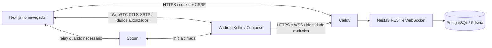

# Arquitetura

`apps/web` apresenta somente dados reais da API; uma instalação vazia não inventa aparelhos ou conexão. `apps/api` autentica, associa recursos ao proprietário e ao acesso administrativo que criou cada sessão, expira solicitações e emite auditoria. `packages/shared` descreve estados/contratos. `apps/android` aplica a autorização final localmente; permissões da API nunca substituem o diálogo do sistema.

O proprietário gera um código; o Android apresenta o servidor e confirma o pareamento por TLS. Uma credencial exclusiva é retornada uma vez. Heartbeats atualizam bateria/conectividade e a lista de pedidos; Android aberto é o modo básico. FCM opcional avisa pedidos e abre a tela de aprovação, sem iniciar captura.

A sessão passa por espera, aprovação, conexão e atividade; recusas, falhas, término e expiração são terminais. A implementação aceita APPROVED → ACTIVE quando a conexão WebRTC informa sucesso, sem exigir um estado CONNECTING intermediário. Pedidos expiram em dois minutos; código de pareamento em cinco. Duração máxima é configurável. Uma sessão por aparelho e um par por papel na sinalização. Reiniciar a API invalida sessões abertas; não há retomada silenciosa.

O navegador cria as transceivers e os canais `control` e `files`; sinalização só começa depois da aprovação. O servidor valida tamanho, formato, origem, papel e propriedade a cada mensagem. Cada cliente WebSocket revalida a credencial. Tráfego de tela e conteúdo de arquivos não passam pela API. Com TURN, somente os pacotes cifrados passam pelo relay.

PostgreSQL fica em rede interna; só Caddy e Coturn publicam portas. O volume do PostgreSQL 18 é montado em `/var/lib/postgresql`, conforme o layout dessa versão. A produção é uma única instância da API; um balanceamento sem coordenação de sinalização quebraria a ligação entre os pares.

O banco guarda usuários, acessos administrativos, dispositivos/credenciais, pareamentos, sessões/permissões, auditoria, metadados de transferências e configurações. Não guarda senha pura, vídeo, texto digitado, token MediaProjection, SMS ou conteúdo privado do aparelho. Auditoria é metadado operacional, sem promessa de inviolabilidade contra o administrador do banco.
